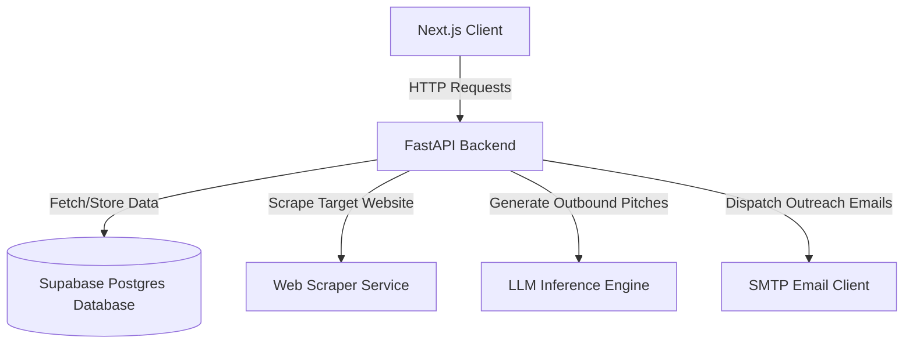

# SalesFlow Automation Hub

A high-performance, AI-driven sales pipeline automation platform built with a **FastAPI** backend and a **Next.js** (App Router) frontend. The system automatically scrapes target websites, enriches contact details, generates personalized, contextual sales pitches via LLMs, manages review queues, and dispatches outbound campaigns.

---

## Project Architecture



- **Frontend**: Next.js 16 (Turbopack, Client Components, App Router, HSL Glassmorphism UI).
- **Backend**: FastAPI (Python 3.10+, Uvicorn, Relational Storage CRUD).
- **Database**: Supabase (Postgres tables tracking `leads` and `lead_events`).

---

## Installation & Setup

Follow these steps to set up and run both the backend and frontend services locally.

### 1. Prerequisites
Ensure you have the following installed on your system:
- **Node.js** (v18.x or higher)
- **Python** (v3.10 or higher)
- **pip** and **virtualenv** (or python `venv` module)

---

### 2. Backend Setup (FastAPI)

1. Navigate to the backend directory:
   ```bash
   cd backend
   ```

2. Create a Python virtual environment:
   ```bash
   python -m venv .venv
   ```

3. Activate the virtual environment:
   - **Windows (PowerShell)**:
     ```powershell
     .venv\Scripts\Activate.ps1
     ```
   - **macOS / Linux**:
     ```bash
     source .venv/bin/activate
     ```

4. Install the backend dependencies:
   ```bash
   pip install -r requirements.txt
   ```

5. Configure Environment Variables:
   Create a `.env` file in the `backend/` directory and configure your credentials:
   ```env
   SUPABASE_URL=your_supabase_url
   SUPABASE_KEY=your_supabase_anon_or_service_key
   GROQ_API_KEY=your_groq_api_key
   RESEND_API_KEY=your_resend_or_smtp_key
   ```

6. Start the FastAPI development server:
   ```bash
   uvicorn main:app --port 8000 --reload
   ```
   The backend API will be available at [http://localhost:8000](http://localhost:8000) and interactive docs at [http://localhost:8000/docs](http://localhost:8000/docs).

---

### 3. Frontend Setup (Next.js)

1. Navigate to the frontend directory:
   ```bash
   cd frontend
   ```

2. Install dependencies:
   ```bash
   npm install
   ```

3. Run the Next.js development server:
   ```bash
   npm run dev
   ```
   The frontend will be available at [http://localhost:3000](http://localhost:3000).

---

## Core Operations

### Running target analysis
- Trigger an analysis pipeline directly from the dashboard modal using **"+ New Target"**.
- This dispatches the scraper and runs the AI copywriter, logging state transitions (`DISCOVERY_SUCCESS` -> `SCRAPER_SUCCESS` -> `AI_GENERATED`) to the database in real-time.

### Reviewing Pitches
- Go to the **Review Queue** tab.
- Click on any target awaiting review. You can customize the subject lines, edit generated pitches, review the audit trail, and save/approve drafts.

### Tracking Campaign Performance
- The **Outreach Log** provides statistics on email deliveries (sent, opened, clicked, bounced) along with detailed execution reports.
