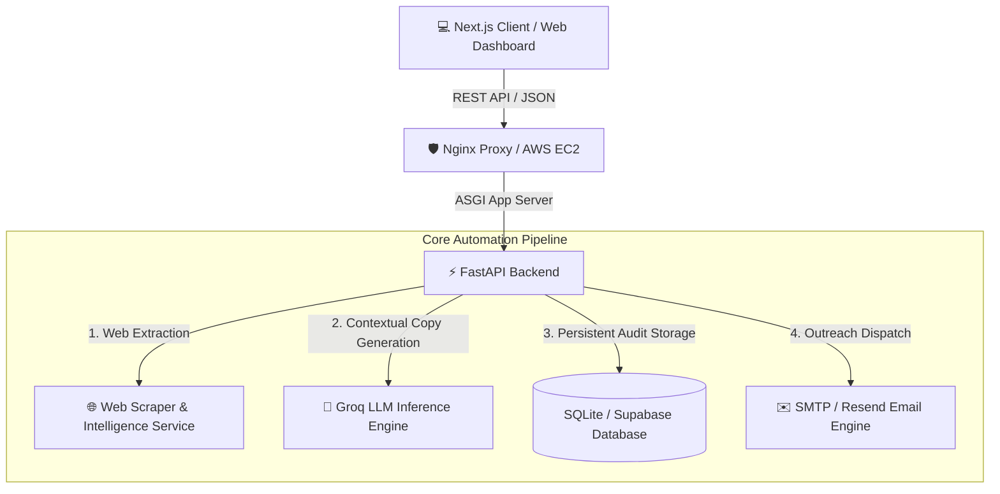

# SalesFlow Automation Hub 🚀

> **AI-Powered Sales Intelligence & Pipeline Automation Platform**  
> An autonomous prospecting platform built with **FastAPI** (Python 3.11) and **Next.js 16** (React 19, Turbopack). Deployed and scaled live on **AWS Elastic Beanstalk**.

---

## 🌐 Live AWS Production Environment

| Component | Status | Live URL |
| :--- | :---: | :--- |
| **Frontend Web Application** |  | 🔗 [sales-frontend-env2.eba-mvr8ucpm.us-east-1.elasticbeanstalk.com](http://sales-frontend-env2.eba-mvr8ucpm.us-east-1.elasticbeanstalk.com) |
| **Backend REST API Service** |  | 🔗 [sales-backend-env.eba-szk7ushs.us-east-1.elasticbeanstalk.com](http://sales-backend-env.eba-szk7ushs.us-east-1.elasticbeanstalk.com) |
| **Interactive OpenAPI Docs** |  | 📖 [sales-backend-env.eba-szk7ushs.us-east-1.elasticbeanstalk.com/docs](http://sales-backend-env.eba-szk7ushs.us-east-1.elasticbeanstalk.com/docs) |

---

## 📐 System Architecture



---

## ✨ Key Features

- **Automated Target Discovery & Scraping**: Extracts company metadata, industry classification, domain profiles, and listed contact information in seconds.
- **AI-Powered Pitch Copywriting**: Leverages Groq LLMs to generate highly customized, contextual outbound email copy per prospect.
- **Verification & Review Queue**: Human-in-the-loop dashboard allowing SDRs to review company overviews, edit subject lines/body copy, and approve drafts before sending.
- **Real-Time Audit Trail**: Complete event history logging (`DISCOVERY_SUCCESS` ➔ `SCRAPER_SUCCESS` ➔ `AI_GENERATED` ➔ `REVIEW_APPROVED` ➔ `EMAIL_SENT`).
- **Outreach Logs & Analytics**: Track email delivery metrics, open rates, and engagement statistics across custom sales campaigns.

---

## 🛠️ Tech Stack & Infrastructure

- **Frontend**: Next.js 16 (App Router, TailwindCSS v4, Material Symbols, Glassmorphism UI)
- **Backend**: FastAPI, Uvicorn, Python 3.11, Pydantic, HTTPX
- **Database**: Relational Storage Engine (SQLite Fallback + Supabase Postgres Integration)
- **AI / LLM Integration**: Groq API (Llama 3 Models)
- **Cloud Infrastructure**: AWS Elastic Beanstalk (Amazon Linux 2023, Node.js 24 & Python 3.11 Runtimes)

---

## 🚀 Local Development Setup

### 1. Prerequisites
- **Node.js** (v18+ or v20+)
- **Python** (v3.10+)
- **Git**

### 2. Backend Setup
```bash
# Navigate to backend directory
cd backend

# Create & activate virtual environment
python -m venv .venv
# Windows (PowerShell)
.venv\Scripts\Activate.ps1
# Linux/macOS
source .venv/bin/activate

# Install dependencies
pip install -r requirements.txt

# Start local backend server
python -m uvicorn main:app --reload --port 8000
```
*Backend runs locally at [http://localhost:8000](http://localhost:8000).*

### 3. Frontend Setup
```bash
# Navigate to frontend directory
cd frontend

# Install npm packages
npm install

# Start Next.js development server
npm run dev
```
*Frontend runs locally at [http://localhost:3000](http://localhost:3000).*

---

## ☁️ Deploying to AWS Elastic Beanstalk

### Deploying Backend (Python)
```bash
cd backend
eb init -p "Python 3.11" sales-automation-backend --region us-east-1
eb deploy
```

### Deploying Frontend (Node.js)
```bash
cd frontend
eb init -p "Node.js 24" sales-automation-frontend --region us-east-1
npm run build
eb deploy
```

---

## 📄 License

Distributed under the MIT License. See `LICENSE` for more information.
